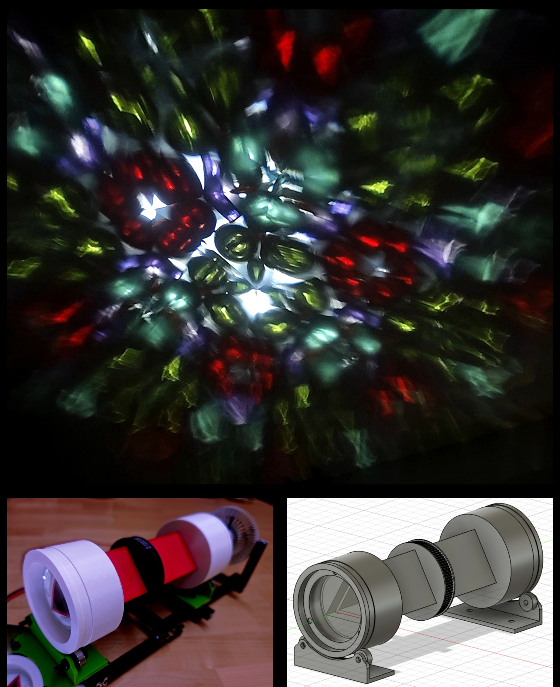

# Kaleidoscope Projector

## Overview

The Kaleidoscope Projector is a small DIY light installation. It projects a colorful, slowly rotating kaleidoscope image onto a wall or ceiling.

I would love to see others build this projector or adapt the design to their own ideas. The build instructions and 3D-printable parts will be available here.

## Background

I had the idea to build a projector that would cast kaleidoscope patterns onto a wall. I could not find any existing projects to build on, apart from a kit featured in a Japanese magazine that was not available to me. So I started designing my own.

The projector consists of a kaleidoscope with a powerful LED shining through it from one end. At the other end, a lens projects the kaleidoscope image onto a wall, or onto the ceiling via a mirror. A small belt drive slowly rotates the kaleidoscope, creating the characteristic changing patterns.

The build combines 3D-printed parts with a lens, a transparent cell filled with colorful glass pieces, a motor, and an LED module.

## Size and projection

The projector measures approximately **30 × 8 × 15 cm** (length × width × height). At a projection distance of around **1–2 m**, the image is approximately **1.5 m in diameter**. The exact size and sharpness depend on the setup and projection distance.
